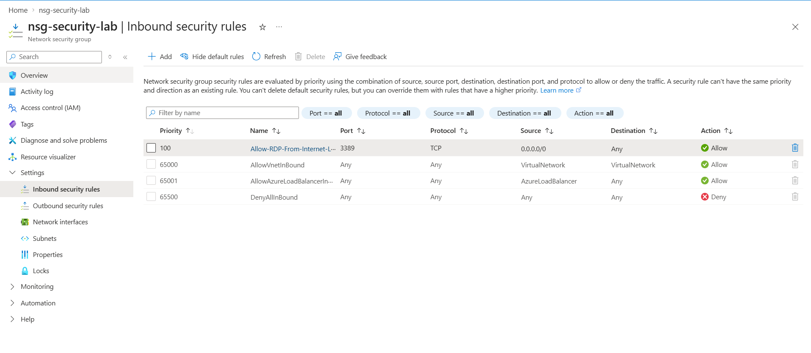
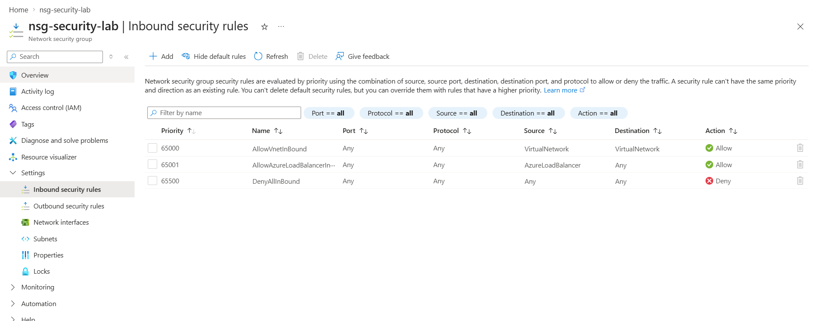

# Azure Network Security Assessment Lab

A hands-on, configuration-based Microsoft Azure Network Security Group (NSG) assessment. I created an intentionally permissive RDP inbound rule in an isolated lab, documented the potential risk, removed the rule, and checked the final NSG configuration.

> **Scope:** This is a configuration assessment, not a penetration test. No VM, public IP address, NIC, or running RDP service was deployed. An NSG allow rule alone does not prove that a service is publicly reachable.

## Lab environment

| Component | Configuration |
|---|---|
| Azure subscription | Azure for Students (personal lab) |
| Region | East Asia |
| Resource group | `rg-azure-security-lab` |
| Virtual network | `vnet-security-lab`, `10.10.0.0/16` |
| Subnet | `snet-assessment`, `10.10.1.0/24` |
| Network Security Group | `nsg-security-lab`, associated with the subnet |
| Compute workloads | None |

## What I did

1. Created a virtual network and subnet in a personal Azure subscription.
2. Created and associated an NSG, then reviewed Azure's default inbound rules.
3. Added a **temporary**, deliberately permissive rule allowing TCP port 3389 from `0.0.0.0/0`.
4. Analysed the potential security implications of an unrestricted RDP source.
5. Deleted the rule.
6. Verified that the NSG had **zero custom inbound rules** after remediation.

## Finding: NSG-001 — Unrestricted inbound RDP

| Property | Test value |
|---|---|
| Rule name | `Allow-RDP-From-Internet-Lab` |
| Priority | `100` |
| Source | `0.0.0.0/0` |
| Source port | `*` |
| Destination | `Any` |
| Destination port | `3389` |
| Protocol | `TCP` |
| Action | `Allow` |

**Risk:** This rule could permit untrusted connection attempts if an RDP-enabled workload were reachable through a suitable network path and host-level controls allowed the traffic. No real exposure was demonstrated in this lab.

**Remediation:** Deleted the custom rule rather than leaving unrestricted RDP access configured.

**Verification:** Rechecked the NSG and confirmed that zero custom inbound rules remained. This confirms the configuration change, **not** a packet-level test.

Read the [detailed finding and remediation report](reports/NSG-001.md).

## Architecture

See the [conceptual Mermaid architecture diagram](diagrams/architecture.md). The diagram is deliberately labelled as configuration-only: it does not represent a live internet-accessible server.

## Evidence

The screenshots below show the temporary test rule and the configuration after remediation. They were captured from this personal Azure lab and reviewed for visible account or subscription identifiers.

**Before — temporary TCP/3389 allow rule from any IPv4 address**

**After — no custom inbound NSG rules**

See [evidence notes](evidence/README.md).

## Tools and concepts

Microsoft Azure · Virtual Networks · Subnets · Network Security Groups · Inbound rule priorities · Least privilege · Risk assessment · Remediation verification

## Assessment limitations

- One simulated finding; not a comprehensive Azure security audit.
- No virtual machine, network interface, public IP address, or running RDP listener.
- No external reachability test, traffic capture, port scan, or exploitation.
- Rule priority and NSG configuration were inspected; workload-level effective rules were not tested.
- This is a personal lab, not an assessment of an employer's environment.

## Cleanup

Delete the lab resources when no longer required, after verifying that the resource group contains only resources created for this lab.
