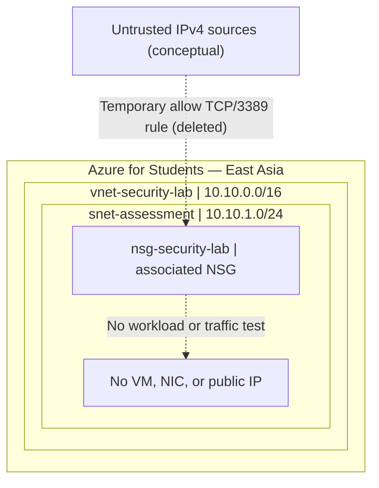

# Lab architecture

This conceptual diagram represents **NSG configuration**, not a live internet-reachable RDP service.

**Before:** A temporary inbound NSG rule allowed TCP/3389 from `0.0.0.0/0` at priority 100.

**After:** The test rule was deleted and zero custom inbound rules remained.

**Limit:** An NSG rule does not by itself make a VM or port reachable from the internet.
