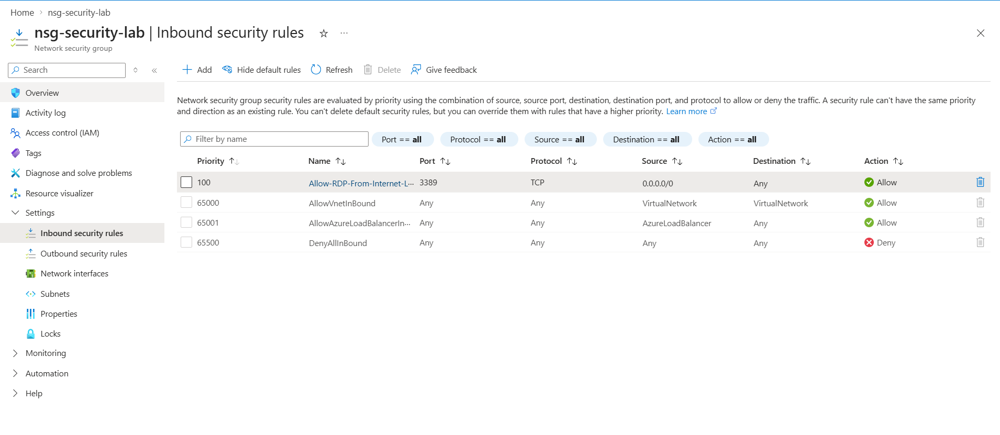
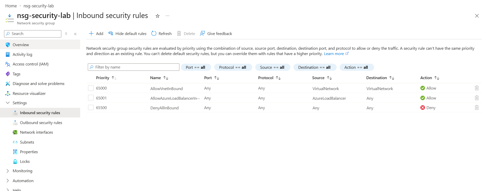

# NSG-001: Unrestricted inbound RDP rule

| Field | Result |
|---|---|
| Assessment | Azure NSG configuration review |
| Status | Remediated; configuration verified |
| Impact | Potentially high **if** an RDP-enabled workload were internet-reachable |
| Environment | Personal Azure for Students lab, East Asia |
| Validation type | Configuration inspection; not live traffic testing |

## Objective

Identify the risk associated with a broadly scoped inbound RDP rule, remediate the test configuration, and verify the resulting NSG rules.

## Observation

A deliberately permissive custom inbound rule was created on `nsg-security-lab`:

- **Rule:** `Allow-RDP-From-Internet-Lab`
- **Priority:** `100`
- **Source:** `0.0.0.0/0`
- **Source port:** `*`
- **Destination:** `Any`
- **Destination port:** `3389`
- **Protocol:** `TCP`
- **Action:** `Allow`

The rule was associated with a subnet, but no VM or NIC was deployed.

## Why this matters

An untrusted source range on an RDP allow rule can increase the attack surface of an internet-reachable Windows workload. Depending on the network and host configuration, it may enable credential-guessing attempts or other unwanted remote access attempts.

The rule **did not establish actual RDP exposure** in this lab. Real reachability depends on a target workload, network routing, public connectivity, listening services, operating system firewall policy, and potentially other controls.

## Remediation performed

Deleted the temporary `Allow-RDP-From-Internet-Lab` rule. Azure's default NSG rules remained in place.

## Verification

After deletion, the NSG displayed **zero custom inbound rules**. This confirms the insecure rule was removed from the reviewed configuration. No network traffic or workload effective-rule test was conducted.

## Recommended controls for a production environment

1. Avoid allowing RDP from `0.0.0.0/0` or `Internet` to internet-reachable workloads.
2. Prefer approved private administrative connectivity; consider appropriately configured Azure Bastion or VPN access.
3. Where remote access is required, restrict sources to authorised ranges and protect identities with suitable authentication and access controls.
4. Review subnet-level and NIC-level effective rules when a VM exists.
5. Repeat the review after configuration changes.

## Evidence status

- [x] [Before: temporary inbound RDP rule](../evidence/NSG-001-Before.png) — source `0.0.0.0/0`, TCP/3389, priority 100, Allow.
- [x] [After: custom rule removed](../evidence/NSG-001-After.png) — default inbound rules remain.

Screenshots are configuration evidence, not proof of packet-level reachability or isolation.

